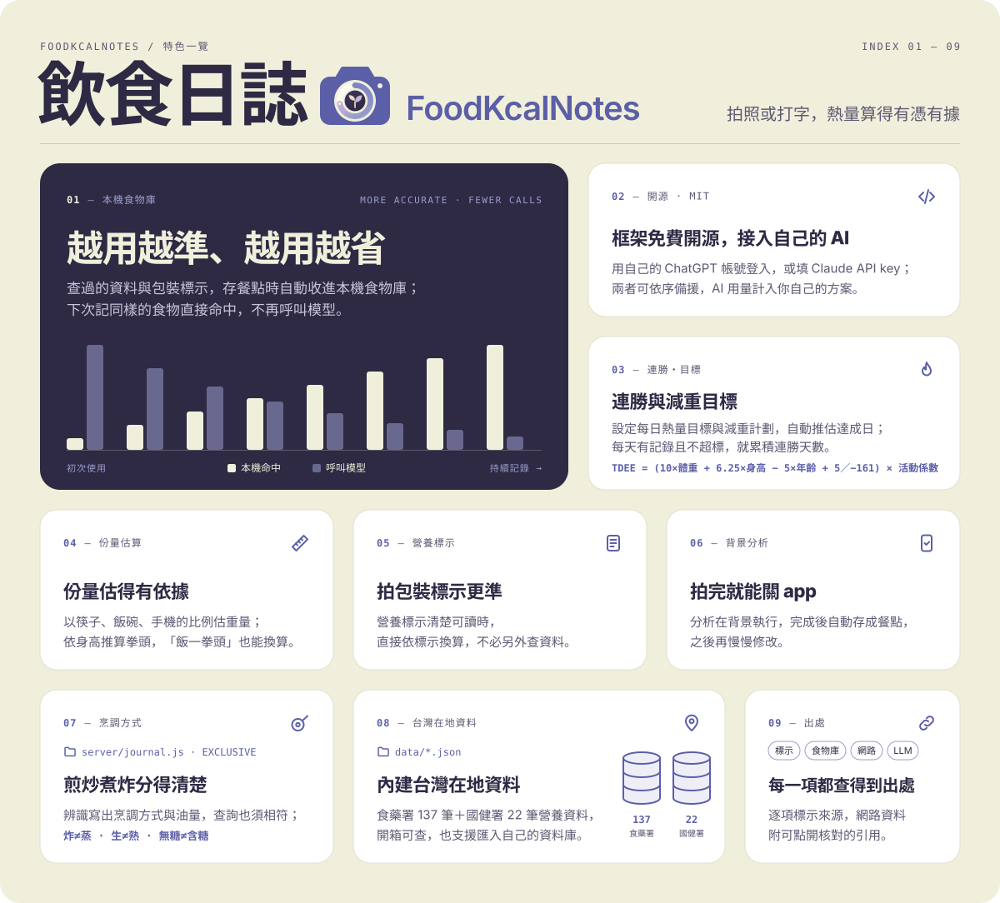
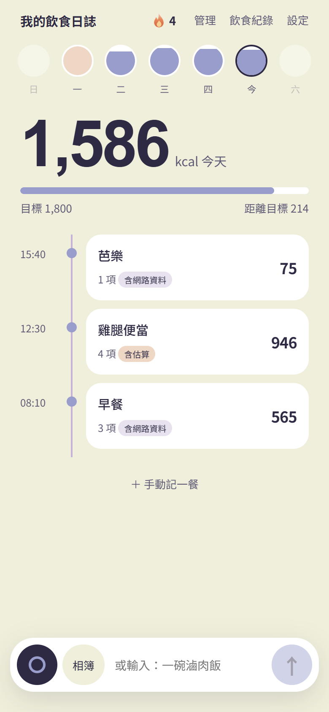
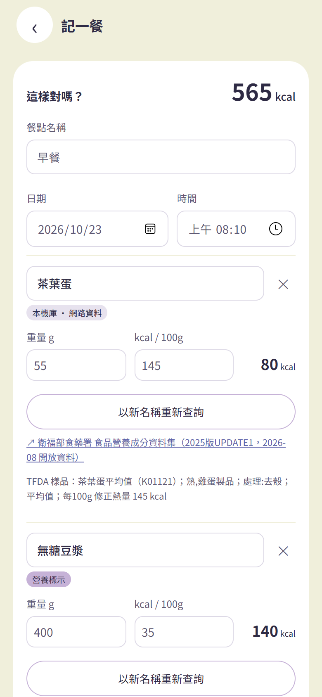
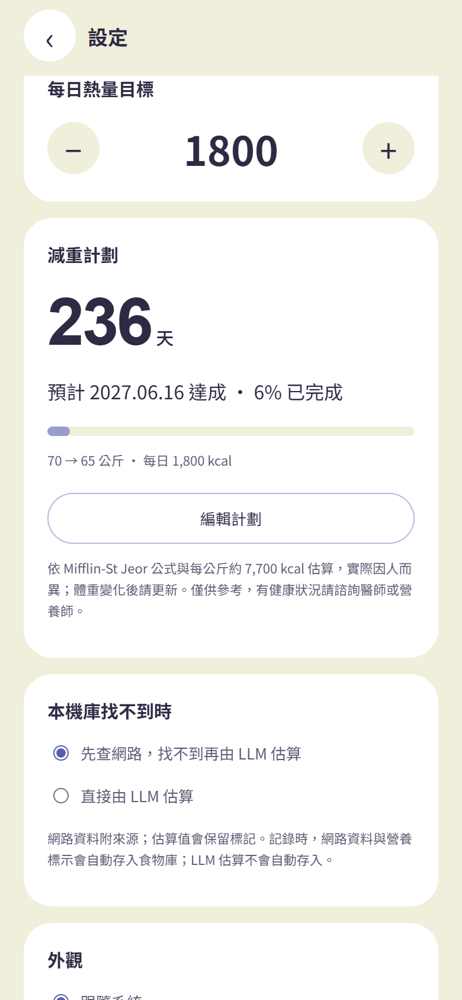
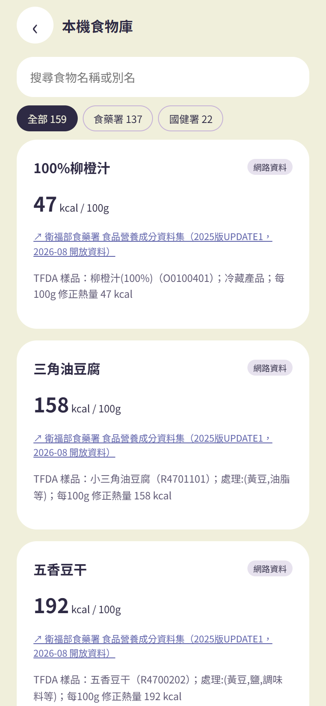
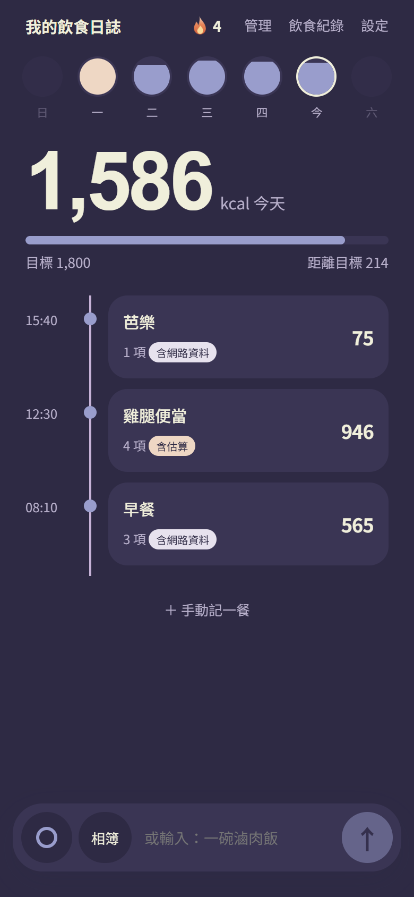
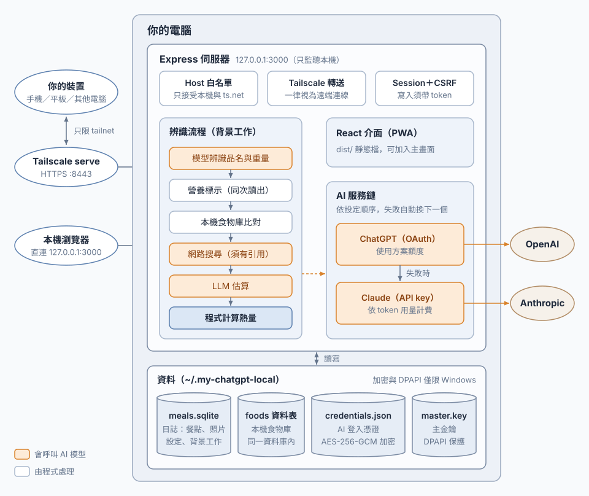
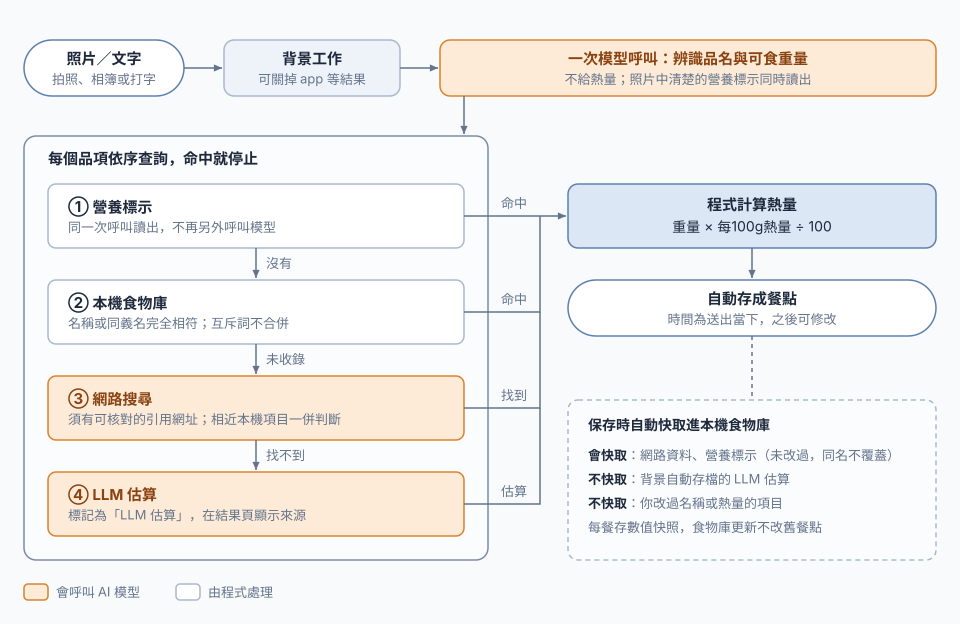

[English](README.en.md) | **繁體中文**

# 飲食日誌 · FoodKcalNotes

在自己電腦上執行的繁體中文飲食熱量日誌（PWA；Express + `node:sqlite` + React/Vite），針對台灣常見食物與份量設計。手機拍照或打字，AI 辨識食物與份量，熱量優先取自本機食物庫與可核對的來源，最後由程式計算。設計原則是**準確優先，其次才是少呼叫模型**。

架構細節（系統、辨識流程、資料庫）見 [`docs/architecture.html`](docs/architecture.html)。

> **授權：** 本專案以 [MIT License](LICENSE) 開源，可自由使用、修改、再發布（含商業用途）。**二次創作或再發布時，請保留原本的版權聲明與 MIT 授權全文。** `data/` 內的營養資料依各自來源授權，使用時請依 [`data/ATTRIBUTION.md`](data/ATTRIBUTION.md) 標示出處。

## 特色

<p align="center"></p>

- **越用越準、越用越省**：網路查到的資料與包裝營養標示，保存餐點時自動存進本機食物庫（同名不覆蓋，改過名稱或熱量的項目不存）；下次記同樣的食物直接命中、不再呼叫模型，AI 判斷為同一種食物時會自動記下新的叫法，你也可以手動按「其實是同一種」教它認得。
- **框架完全免費開源，只需接入自己的 AI**：程式本身免費、以 MIT 授權開源；只要用自己的 ChatGPT 帳號 OAuth 登入（不需 OpenAI API key），或填自己的 Claude API key 即可使用，兩者可同時設定、依順序自動備援。AI 用量計入你自己的方案或帳戶。
- **連勝與減重目標**<br>`TDEE = (10 × 體重kg + 6.25 × 身高cm − 5 × 年齡 + 5〔男〕／−161〔女〕) × 活動係數`<br>設定每日熱量目標與減重計劃（依 Mifflin-St Jeor 公式推估每週減重與預計達成日）；從今天往回數，每天有記錄且不超過目標就累積連勝，首頁以火焰圖示顯示。
- **份量估得有依據**：以照片中的筷子、飯碗、手機等常見物品比例估重量，並依你的身高推算拳頭大小，文字寫「飯一拳頭」也能換算。
- **拍包裝標示更準**：照片中的營養標示清楚可讀時，直接依標示換算，不必另外查資料。
- **拍完就能關 app**：分析在背景執行，完成後自動存成餐點，之後再慢慢修改；改名後「以新名稱重新查詢」只重查那一項。
- **煎炒煮炸分得清楚**：提示詞特別要求辨識時寫出看得到的烹調方式與油量（乾煎雞腿、炸雞排、油亮炒青菜、清燙、勾芡），查資料時烹調狀態也必須相符；程式另外擋下炸≠蒸、生≠熟、無糖≠含糖等互斥詞，茶葉蛋、滷蛋、水煮蛋也不會混為一談。互斥詞清單位於 `server/journal.js` 的 `EXCLUSIVE`，可依需求自行增修。
- **內建台灣在地資料**：附食藥署食品營養成分資料 137 筆、國健署「熱量知多少」22 筆，蛋餅、小籠包、蚵仔煎這類早餐與小吃開箱就查得到；也支援用 `npm run import-foods` 匯入自己整理的資料（格式同 data/*.json）。內建資料位於 `data/*.json`。
- **每一項都查得到出處**：逐項標示來源（營養標示／本機食物庫／網路資料／LLM 估算）；網路資料附可點開核對的引用，且引用網址必須真的出現在搜尋結果中才算數。

## 設計依據（研究）

- **份量是最大誤差來源，所以克數可隨時修正、熱量由程式即時重算**：研究顯示，提供各食材的正確重量後，多模態 LLM 的熱量誤差由約 51% 降到最低 29%（[Bhatambarekar, Virginia Tech 碩士論文, 2025](https://vtechworks.lib.vt.edu/items/b67c2a61-f283-41ba-9602-9798306b9529)）；ChatGPT-5 只看照片時熱量 MAPE 為 30.5%，加上詳細食材資訊後降到 13.9%（[Nutrients, 2025](https://pmc.ncbi.nlm.nih.gov/articles/PMC12655113/)）。本程式的克數仍由 AI 估計，但每 100g 熱量取自可核對的資料，改正克數就會立即重算，不需重新呼叫 AI。
- **提示詞加入用餐時段**：在提示詞加入時間、地點等情境資訊後，各模型的份量平均誤差約減少 53 g（[arXiv:2507.07048, 2025](https://arxiv.org/abs/2507.07048)）；本程式只加入時段，不使用位置。
- **預設使用 ChatGPT，Claude 為可選備援**：Nutrition5k 多食物餐點的單項克數誤差（PMAE），GPT-5.5 為 38.7%，Claude Opus 4.8 與 Fable 5 約為 51–53%（[arXiv:2607.16514, 2026](https://arxiv.org/abs/2607.16514)）；另一項研究中各模型都低估克數 12–37%，Haiku 5.5 約 −37%（[arXiv:2610.26538, 2026](https://arxiv.org/abs/2610.26538)）。順序可在設定中調整。
- **不做單目深度或 3D 重建**：單張照片的深度資訊在上述研究中未帶來改善（[arXiv:2607.16514, 2026](https://arxiv.org/abs/2607.16514)）；MetaFood 2025 單張照片體積估計中，最佳的 3D 重建方法 MAPE 為 0.21，GPT-5.2 直接估計為 0.34（[arXiv:2602.13041, 2026](https://arxiv.org/abs/2602.13041)）；3D 重建較準，但需另建一整套重建流程，本程式改以照片中的參照物比例估重。
- **不把舊照片當範例送給模型**：多模態 in-context learning 主要依賴文字，圖片幾乎沒有影響（[CVPR 2024 Workshop](https://arxiv.org/abs/2404.15736)）；在提示詞加入 5 筆最相近的資料庫餐點後，熱量 MAE 只從 120.38 變為 120.21（[SnappyMeal, 2025](https://arxiv.org/abs/2511.03907)）。

數字為原論文在其資料集上的結果，實際效果依使用情境而異。

設計決策紀錄（ADR）見 [`docs/decisions/`](docs/decisions/)。

## 功能

<p align="center">
  
  
  
</p>
<p align="center">
  
  
</p>
<p align="center"><sub>首頁 · 結果頁 · 每日目標與減重計劃 · 本機食物庫 · 深色外觀（皆為示範資料）</sub></p>

- **記錄**：拍照、選相簿照片，或輸入文字（例如「一碗滷肉飯，飯約150克」）。不設定 AI 也能手動記一餐。
- **背景分析**：送出後在背景執行，可以關掉 app；完成後**自動存成餐點**（時間為送出當下），之後可再修改。
- **熱量來源**：包裝營養標示 → 本機食物庫 → 網路搜尋（須有可核對的引用）→ LLM 估算，每項都標示來源。熱量＝重量 × 每100g熱量 ÷ 100，由程式計算，不由模型給。
- **結果頁**：可改名稱、重量、每100g熱量、日期時間；「以新名稱重新查詢」只在背景重查單一項目；熱量為 0 的項目可用「AI 估算」；「其實是同一種」把辨識名記成本機食物的同義名。
- **首頁**：每日餐點與總熱量、每週切換；連勝 🔥＝從今天往回數「有記錄且當日總熱量不超過目標」的連續天數。
- **減重計劃**：基本資料 → 活動量 → 依每日目標估算每週減重與達成日。算法：1. 每日消耗 TDEE ＝ BMR（Mifflin-St Jeor）× 活動係數；2. 每週減重 ＝ (TDEE − 每日目標) × 7 ÷ 7,700 kcal，再推算達成日（目標低於建議最低攝取會提醒）。
- **AI 服務**：ChatGPT 登入與 Claude API key 可同時設定，依順序使用並自動備援。
- **手機使用**：透過 Tailscale serve 從自己的手機開啟，與電腦使用同一本日誌。
- 淺色／深色外觀、匯出 JSON 備份。

## 架構概覽

### 系統架構

<p align="center"></p>

伺服器只監聽 127.0.0.1；手機等裝置經 Tailscale serve 連回同一台電腦，共用同一本日誌與伺服器端憑證。

### 辨識與熱量流程

<p align="center"></p>

橘色步驟會呼叫模型，其餘由程式處理；營養標示與食物庫命中的項目不再另外呼叫模型（省 token）。保存時，未經修改的「網路資料」與「營養標示」結果自動快取進食物庫；背景自動存檔的 LLM 估算與使用者改過的項目不快取。

## 快速開始

需要 **Node.js 24 以上**（使用 `node:sqlite`）。

**Windows**：雙擊專案根目錄的 `start.bat`。第一次會 `npm ci`，接著建置畫面、設定 Tailscale serve（有安裝時）、啟動服務並開啟 **http://127.0.0.1:3000**。已在執行時只會開網頁；關閉視窗或按 `Ctrl+C` 即停止。

**macOS／Linux**：

```sh
npm ci && npm run build && npm start
```

然後開啟 http://127.0.0.1:3000。連接埠預設 3000，可用環境變數 `PORT` 覆寫。

> 憑證保護：Windows 上憑證以 AES-256-GCM 加密，主金鑰由 Windows DPAPI 保護；macOS／Linux 沒有 DPAPI，`credentials.json` 是**明文**，只靠資料夾 0700、檔案 0600 權限保護。

## AI 服務

在電腦上開「設定 → AI 服務」設定。可以只用其中一種，也可以兩種都啟用。

ChatGPT 登入憑證與 Claude API key 只保存在電腦上的 `credentials.json`（Windows 上加密，見上方「憑證保護」），不會傳到瀏覽器或其他裝置；透過 Tailscale serve，你的多部裝置（手機、平板、其他電腦）都能連回這台電腦，使用同一份伺服器端憑證。ChatGPT 登入只限你自己的帳號使用，依 OpenAI 使用條款，請勿分享帳號或額度；Claude API 的用量計入該 API key 所屬的帳戶。

- **ChatGPT（選用）**：按 Continue with ChatGPT 登入並授權，再選辨識模型（照片需要支援影像輸入的模型）。使用你 ChatGPT 方案的額度，不需要 OpenAI API key。登入、切換、登出**只能在電腦上**的 `http://127.0.0.1:3000` 進行，因為授權回程網址固定在本機。
- **Claude API**：到 [Claude Console](https://console.anthropic.com/) **在一個 Workspace（工作區）內**建立 API key，貼到設定中。保存前會先以免費的 Token Counting API（所選模型）驗證，無效就不保存；未綁定工作區的金鑰會被拒絕並提示原因；畫面只顯示末四碼。可選 Haiku 5.5（預設，最便宜）、Sonnet 5.5、Opus 5.5。
- **順序與備援**：每次呼叫使用清單中第一個啟用且可用的服務；遇到授權失效、額度或限流、伺服器錯誤、逾時（已重試 1 次）、網路錯誤，或該服務不接受的要求（HTTP 400）時，自動改用下一個。每個 AI 處理的項目都會在備註註明實際處理的服務與模型（例如「（由 Claude Haiku 5.5 處理）」）。
- **費用**：ChatGPT 消耗方案額度；Claude API 依 Anthropic 的用量計費（按 token 計算，網路搜尋另計），請在 Console 設定用量上限。每餐固定 1 次辨識呼叫，本機食物庫命中的項目不再呼叫模型。

## 從手機使用（Tailscale）

服務只監聽 127.0.0.1。要從自己的手機使用，由 [Tailscale](https://tailscale.com/download) serve 把 `https://<電腦名稱>.<tailnet>.ts.net:8443` 轉到本機 3000，只有你的 tailnet 內連得到。電腦需開機並執行服務。沒有 Tailscale 時也可以只在本機使用。**不要**改用其他反向代理直接公開：伺服器信任 Tailscale 附上的身分標頭，其他代理下這個標頭可能被偽造。

1. 電腦與手機安裝 Tailscale，登入同一帳號。
2. 執行 `tailscale serve --https=8443 --bg 3000`（Windows 的 `start.bat` 會自動執行）。
3. 在專案根目錄建立 `start.local.bat`（已列入 `.gitignore`；macOS／Linux 改設環境變數）：

   ```bat
   set "REMOTE_ORIGINS=https://<電腦名稱>.<tailnet>.ts.net:8443"
   set "OWNER_LOGIN=<你的 Tailscale 登入帳號>"
   rem 選填：Tailscale 不在預設位置時
   rem set "TAILSCALE=C:\Program Files\Tailscale\tailscale.exe"
   ```

   `REMOTE_ORIGINS` 是手機開啟的網址；`OWNER_LOGIN` 是你的 Tailscale 登入帳號，讓手機與電腦使用同一本日誌。
4. 手機開啟 ts.net 網址，瀏覽器選「加入主畫面」。

ChatGPT 登入與 AI 服務設定只能在電腦上操作；手機可以記錄、查看與修改餐點。

## 資料與食物庫

- **本機食物庫**：存在日誌資料庫中；app 內唯讀，沒有新增／修改／刪除介面。
- **自動快取**：保存餐點時，未經修改的「網路資料」與「營養標示」結果自動寫入食物庫，同名不覆蓋。背景自動存檔的 LLM 估算一律不寫入；但使用者在結果頁按「AI 估算」並確認保存的結果會寫入。使用者改過名稱或熱量的項目不寫入。每餐保存當時的數值快照，食物庫之後更新不會改動舊餐點。
- **內附資料**：`data/tfda-common.json`（食藥署食品營養成分資料集，137 筆）與 `data/hpa-2018-dishes.json`（國健署「熱量知多少」2018，22 筆）。來源與授權見 [`data/ATTRIBUTION.md`](data/ATTRIBUTION.md)。
- **維護者匯入**：

  ```sh
  node scripts/import-foods.mjs data/tfda-common.json data/hpa-2018-dishes.json [--dry-run]
  ```

  也可用 `npm run import-foods -- data/xxx.json [--dry-run]`。加 `--dry-run` 只回報將新增、略過、無效的筆數，不寫入；正式匯入前自動備份資料庫（同資料夾的 `meals-backup-時間.sqlite`），名稱或別名已存在的項目略過、不覆蓋。品牌資料（連鎖餐飲的營養標示等）不隨專案發佈，可自行整理成相同格式匯入，並自行確認來源的使用條款。不得把「每份熱量」直接當成「每100g熱量」；不同品牌、烹調方式、生熟狀態請用不同名稱。

### 資料位置與備份

```text
~/.my-chatgpt-local/            （Windows：%USERPROFILE%\.my-chatgpt-local；可用 MEAL_JOURNAL_DATA_DIR 改位置）
  credentials.json              ChatGPT 登入憑證、Claude API key
  master.key                    加密主金鑰（僅 Windows，DPAPI 保護）
  meals.sqlite                  日誌：餐點、照片、設定、背景工作、本機食物庫
```

- 「設定 → 匯出日誌與食物備份」下載 JSON（不含憑證）。完整備份請在服務停止後複製 `.sqlite` 檔（連同 `-wal`、`-shm`）。
- Windows 換電腦或換帳號後無法解開憑證：刪除 `credentials.json` 與 `master.key`，重新登入／設定 API key 即可，日誌不受影響。

## 隱私

- 照片與描述會依你設定的服務送到 **OpenAI 或 Anthropic** 做辨識；網路搜尋只使用食物名稱與描述。其餘資料都留在你的電腦上。
- 憑證只存在後端，不放在瀏覽器；Windows 上加密保存，macOS／Linux 為 0600 明文。所有寫入都需要 HttpOnly session 與 CSRF token。
- 經 Tailscale 轉送的要求（帶 `Tailscale-User-Login` 或 `X-Forwarded-*` 標頭）一律視為遠端，偽造 `Host: 127.0.0.1` 也不會被當成本機。
- 本機連線不需登入：同一台電腦上的其他程式或其他作業系統使用者，也能以你的完整權限連到 `127.0.0.1:3000`。
- `start.local.bat`、資料庫與憑證都不進 git。

## 開發

```sh
npm test          # 模擬 OAuth 與模型，不耗額度
npm run build
npm run dev
```

開發模式（`npm run dev`）會拒絕所有遠端（Tailscale）要求，只限本機使用。

測試其他 Tailscale 身分用的伺服器旗標（`CHATGPT_SHARED`、`FRIENDS_CACHE`）說明見 [`server/README.md`](server/README.md)。

## 免責聲明

ChatGPT 登入是選用功能，依 OpenAI「Sign in with ChatGPT」開源 app 文件（https://developers.openai.com/siwc/token-sharing-open-source）實作，只供使用者在自己的電腦用自己的帳號；須遵守 OpenAI 使用條款，不得分享帳號。本專案與 OpenAI、Anthropic 無關聯，亦未獲背書。本工具不提供醫療或營養建議，熱量為估計值，照片無法準確判斷份量、隱藏油量或完整配方，請在結果頁核對。

## 維護狀態

這是個人專案，不保證後續會持續維護，也不一定會回覆 issue 或合併 PR。歡迎自由 fork，依自己的需求修改。

## 授權

程式碼採 [MIT License](LICENSE)。`data/` 內的資料依各自來源授權，見 [`data/ATTRIBUTION.md`](data/ATTRIBUTION.md)。
